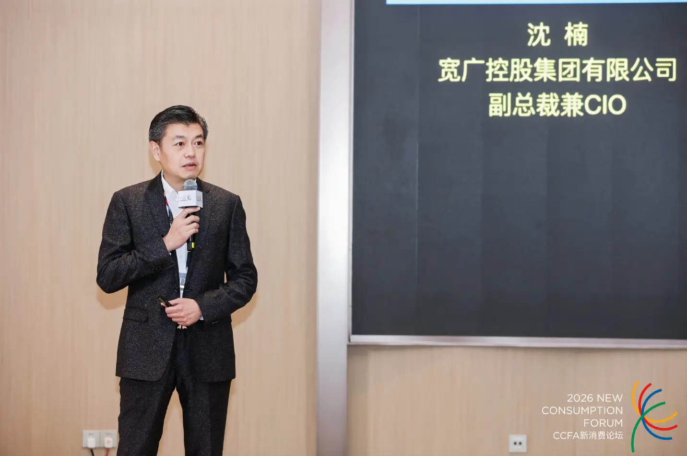
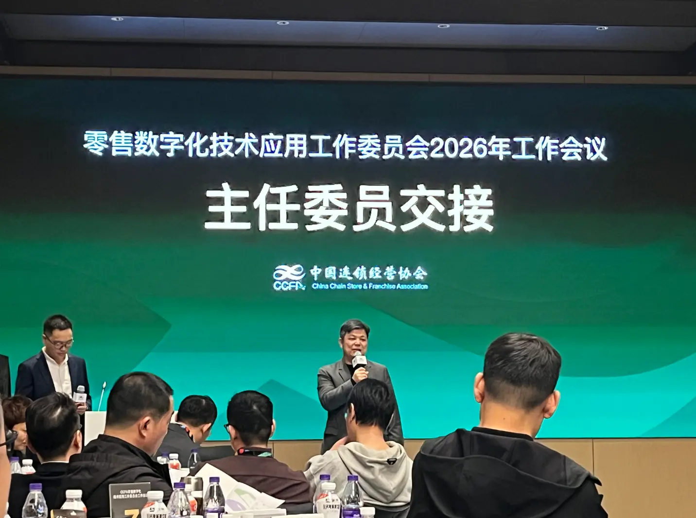
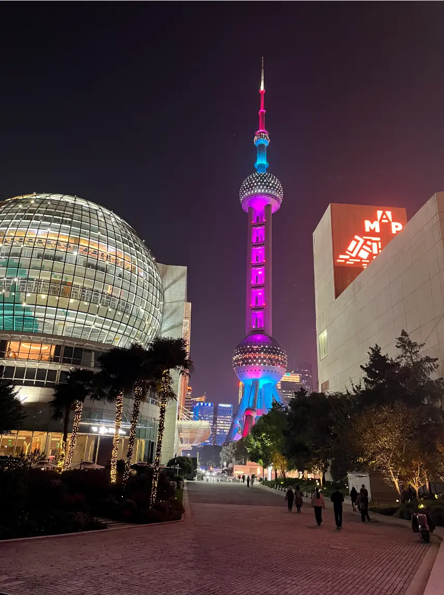
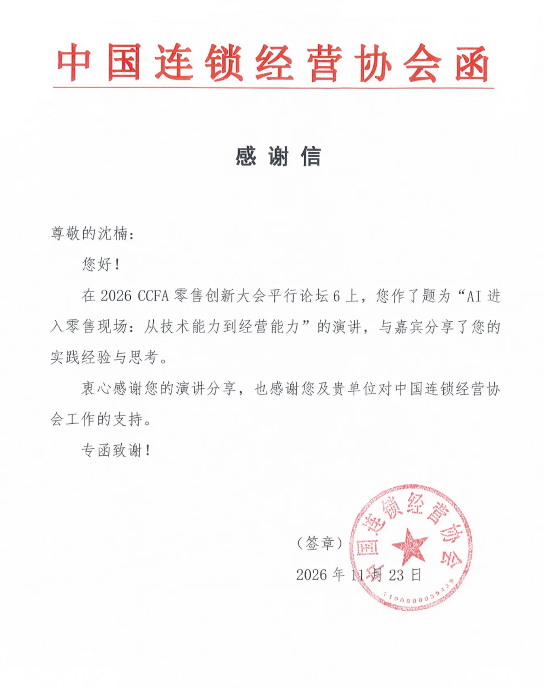

11月17日，我在上海参加了中国连锁经营协会（CCFA）举办的2026零售创新大会，并在“零售+AI”平行论坛作了一场20分钟的分享。

演讲题目是《AI进入零售现场：从技术能力到经营能力》。

从河北承德到上海，从企业内部的技术讨论到全国性的行业交流，虽然只是一次短短的演讲，却也让我重新整理了一遍这些年来关于信息化、人工智能和企业经营的思考。

## 一、从承德说起

宽广集团是一家扎根河北承德的区域零售企业。

我们拥有大型超市、便利店、百货、奥特莱斯以及物流和食品加工等业务，约有2750名员工，经营规模在20亿元左右。

与那些全国性的大型零售集团相比，我们的规模并不算大，技术资源也相对有限。

但企业经营中遇到的问题，其实并没有太大的区别。

每天都有大量的销售数据产生，每天都有采购、补货、商品调整和会员运营等决策需要完成。

管理人员希望及时了解经营情况，业务部门希望提高效率，技术部门则需要想办法让这些数据真正发挥作用。

在过去很长一段时间里，我们建设了ERP、BI、会员系统以及各种业务管理平台。

这些系统积累了大量数据，也支撑着企业日常运转。

但一个始终存在的问题是：

**我们拥有越来越多的数据，却不一定能够越来越方便地使用这些数据。**

这也成为我们尝试将人工智能引入经营现场的起点。

## 二、这不就是宽广的豆包嘛？

在演讲中，我讲了一个发生在企业内部的小故事。

有一次，我向董事长介绍我们正在建设的AI问数系统。

我解释了自然语言理解、大模型、MCP、数据库连接和自动查询等技术原理，还介绍了系统如何分析经营数据。

讲了半天，董事长听明白了，说了一句：

**“这不就是宽广的豆包嘛？”**

我觉得这个比喻十分贴切。

从技术角度看，两者当然存在区别。但从企业管理者的使用体验来说，他所期待的其实非常简单：

像使用日常AI助手一样，向企业自己的系统提问。

例如：

“昨天生鲜卖得怎么样？”

“哪几家门店销售下降了？”

“这家店6月份，每个小时平均有多少笔交易？”

过去，这些问题可能需要打开BI系统、查询ERP，甚至导出Excel重新计算。

现在，我们尝试通过大模型理解问题，再利用MCP连接企业的数据查询工具，由系统返回结果。

这意味着，企业多年积累的数据，正在获得一种新的访问方式。

当然，能够回答问题，并不意味着回答一定正确。

数据的统计口径是否一致？查询结果能否回到原始报表复核？系统有没有越权访问？

这些问题仍然需要解决。

我们逐渐形成了一套基本思路：

**先确定口径，再查询数据；先复核结果，再进入经营流程。**

AI可以帮助我们更方便地找到答案，但经营责任不能因此交给AI。

## 三、技术进入经营，远比演示复杂

除了AI问数，这次我还介绍了几个实际业务场景。

其中一个是生鲜自动补货。

对于超市而言，生鲜补货是一件看似简单、实际却很复杂的工作。

订多了，可能产生损耗；订少了，又会导致缺货。

我们尝试使用近两年的销售历史数据，借助XGBoost、LightGBM等机器学习方法预测销售，再结合库存和在途数量生成订货建议。

在试点过程中，订货操作耗时初步反馈约减少一半。

这是一个令人鼓舞的变化。

但我在演讲中也特别强调：

**订货变快，不等于经营效果已经变好。**

缺货率有没有下降？损耗有没有减少？门店是否愿意持续使用？系统建设和运行需要多少成本？

这些都需要进一步观察。

另外，我们还尝试将AI用于人力资源360度评价结果的整理、会员分群分析以及商品选品辅助等工作。

不同业务的技术实现并不完全相同，但有一个共同点：

AI不能只是展示某种令人惊讶的能力，而必须能够融入企业已有的经营流程。

真正有价值的，不是系统替我们生成了一份漂亮的报告，而是这份报告有没有人看、有没有人用，最终有没有带来经营上的改善。

## 四、理想与预算之间

演讲中，我还谈到了一个很现实的问题。

刚开始研究AI应用时，看到各种技术方案和可能性，总觉得前景十分美好。

但当服务器、算力、系统开发和运行维护成本摆到桌面上时，感受又完全不同。

我用了一个略带玩笑的说法：

**“一开始觉得春天来了，一看投资，又觉得秋天来了。”**

技术人员有时天然地追求更先进的技术、更强大的算力和更完善的架构。

但企业管理者需要考虑另一件事：投入与产出。

对于一家区域零售企业而言，资源总是有限的。

我们不可能因为AI技术发展迅速，就不断更换设备、重建系统，也不可能把每一种新技术都尝试一遍。

因此，我越来越倾向于一种比较务实的方式：

能利用既有系统的，就不轻易推倒重来；能使用成熟技术的，就不必事事从头研发；能够通过小范围试点验证的，就不急于全面推广。

技术方案可以很复杂，但经营决策应该尽可能简单。

## 五、模型会变，企业自己的能力要留下来

这两年，人工智能的发展速度令人惊讶。

从最初主要用于对话、写作，到逐渐能够调用工具、分析数据、执行任务，变化几乎以月为单位发生。

今天使用的模型，过一段时间可能就会被性能更好的模型替代。

但企业不可能跟着模型的变化，不断重建自己的业务系统。

我在演讲最后谈到了一个想法：

**模型可以更换，但企业的数据资产、业务规则和工具能力，应该尽可能沉淀下来。**

传统ERP记录交易，BI系统沉淀指标口径，MCP等标准化连接方式让模型能够调用经过授权的工具。

这样的架构，使我们有机会在保留既有系统的基础上，逐步引入新的智能能力。

对企业而言，真正重要的并不是选择了哪个大模型，而是有没有建立一套能够长期使用、持续改善的业务能力。

我认为，这才是人工智能从技术能力走向经营能力的重要一步。

## 六、一次分享，也是一次整理

这次上海之行，对我来说还有另外一层意义。

我从事信息技术工作已经很多年。

从早期的通信网络、IDC和ICT，到后来负责企业信息化、数据治理，再到今天推动人工智能应用，技术发展的方向不断变化。

但回过头来看，企业需要解决的许多问题，其实始终没有变。

如何获得准确的信息，如何提高工作效率，如何让管理者作出更好的决策，如何在有限的资源下创造更多价值。

这些问题，在不同年代，只是有了不同的技术解决方式。

准备这次演讲的过程，也让我有机会重新审视我们已经完成的工作和仍然存在的不足。

有些项目已经开始产生实际效果，有些仍处于试点和验证阶段，还有一些想法，距离真正落地尚有不小的距离。

这都很正常。

企业数字化不是一场可以迅速结束的比赛，人工智能也不会因为一次技术突破，就自动解决所有经营问题。

它更像是一项持续进行的工作。

做一点，验证一点；发现问题，再调整方向。

## 七、最后的三个问题

在演讲的最后，我没有用宏大的技术愿景结束，而是留下了三个简单的问题：

**这笔数据从哪里来？**

**出了结果，谁来确认？**

**确认以后，谁会用、用在哪一步？**

这些问题听起来并不复杂，却贯穿了企业从信息化到智能化的整个过程。

技术可以帮助我们更快地获得答案，但答案是否可信、能否用于经营，仍然取决于企业自身的管理能力。

从承德到上海，带去的是宽广集团的一些实践，也带回了对自己工作的进一步思考。

人工智能正在改变许多事情。

但我想，真正值得关注的，并不是AI能够做出多少令人惊讶的演示，而是有多少普通企业、普通岗位，能够在日常工作中逐渐用好它。

**技术终究是工具，经营才是目的。**

这大概也是我这次演讲，最想表达的一句话。

---

*2026年11月22日，记于承德。*

*本文根据2026年11月17日CCFA零售创新大会主题演讲及个人思考整理。*
