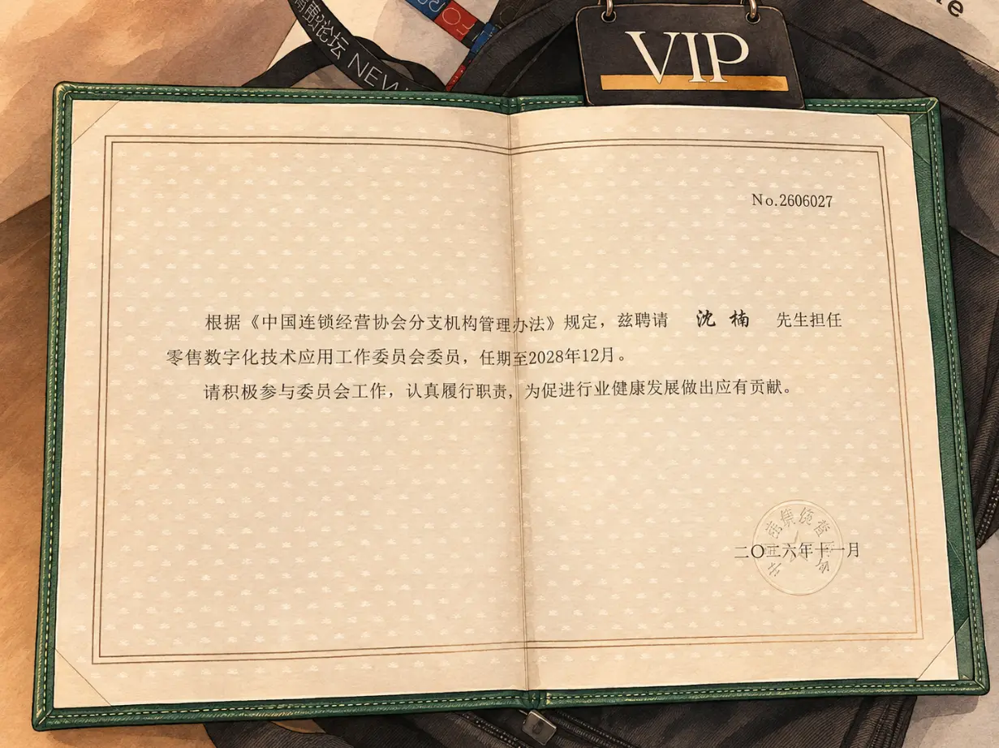
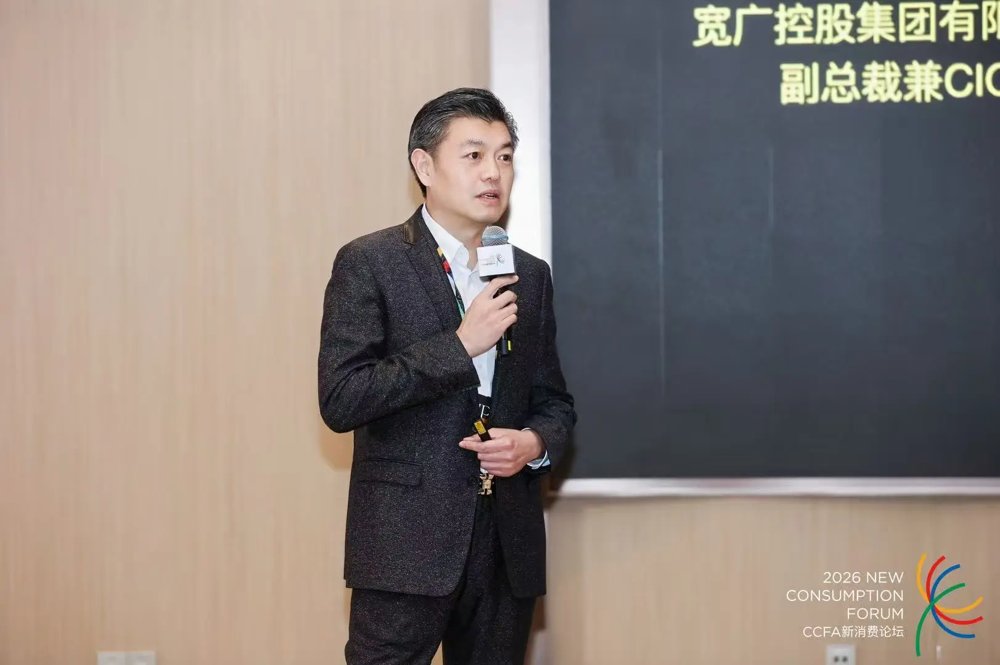
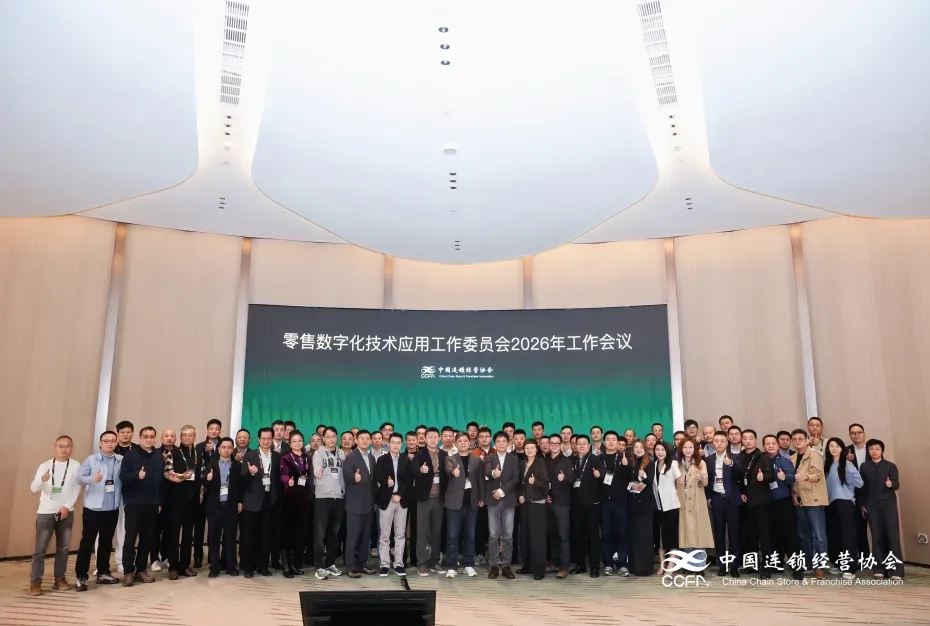
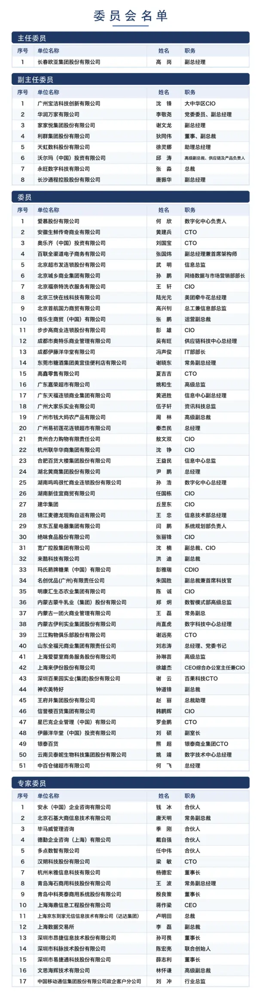

2026年11月17日，在上海召开的中国连锁经营协会零售数字化技术应用工作委员会年度工作会议上，我被正式增补为委员会委员。

会议纪要中，一行简短的文字记录了这次增补：

**沈楠，宽广控股集团有限公司副总裁兼CIO。**

对我而言，这是一份荣誉，也是一份来自行业的认可。

## 一路走来

回想自己的职业经历，从早年的通信网络、IDC、ICT，到后来进入零售企业，负责信息化建设、数据治理以及今天的人工智能应用，不知不觉已在信息技术领域工作了许多年。

2014年离开运营商，来到宽广集团，转眼也将近十三年。

从通信行业转向零售行业，改变的不仅是工作环境，还有看待技术的角度。

过去更多关注系统、网络与技术能力，如今则需要考虑技术如何服务经营、如何控制成本、如何真正解决企业的问题。

这些年做过不少项目，有成功的经验，也有曲折和遗憾。技术不断更新，企业面临的问题却往往比想象中复杂。

而这些经历，恰恰成为今天参与行业交流的基础。

## 一份认可

这次增补的委员，来自零售、食品、商业连锁及科技等不同领域，其中有不少大型企业的数字化负责人。

能够以一家承德区域零售企业管理者的身份参与其中，我感到欣慰。

宽广集团并非全国性零售巨头，但我们同样面对数字化转型中的现实问题，也一直在有限的资源条件下探索适合自己的解决方案。

在同一天举行的CCFA零售创新大会“零售+AI”平行论坛上，我还分享了宽广集团近年来的人工智能实践。

一边是交流已有的探索，一边是获得新的行业交流机会。

两件事情发生在同一次上海之行，也让这次经历多了一层意义。

## 继续向前

在我看来，行业组织委员的身份并不意味着拥有了多少成就，更重要的是有机会接触不同企业的实践，参与行业讨论，开阔视野。

技术工作做得越久，越能体会到知识和经验的局限。

尤其是人工智能快速发展的今天，过去积累的经验固然重要，持续学习同样不可或缺。

未来，希望能够将区域零售企业的真实实践带入行业交流，也从更多优秀企业的经验中获得启发。

回望来路，从通信行业到零售行业，从企业内部的信息化建设到今天参与行业数字化交流，每一步似乎都很平常。

只是多年积累之后，再回头看，才发现这些经历已经连成了一条清晰的线。

**这份受聘，是一段经历的记录，也是继续学习和前行的新起点。**

---

*2026年11月23日，承德*

## 附：会员名单

