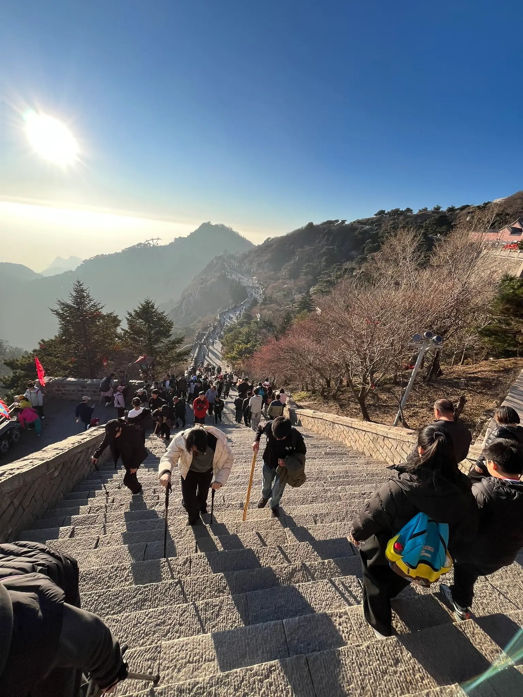

因参加北森的一场会议，来到山东泰安。会议之余，偷得半日闲，登了一次泰山。

时间有限，我选择乘坐索道上山。下了索道，再步行约半个小时，便登上了泰山之巅——玉皇顶。而如果从山脚下徒步攀登，据说需要五个小时左右，甚至更久。

泰山为五岳之首，自古便有着非同寻常的地位。历代帝王曾在此封禅，祭告天地。作为中国人，登临泰山之巅，总有一种特别的感受。

站在山顶，极目远眺，忽然想到一个有趣的问题。

同样是登顶泰山，有人从山脚下一步步攀登，汗流浃背，历时数个小时；有人如我，乘坐索道，轻轻松松便抵达了同样的高度。

站在山顶，其实很难分辨彼此的来路。汗流浃背的人，未必是一路攀登上来的；神清气爽的人，也未必没有经历过艰辛。

**山顶不会因为谁付出了更多，就给予谁更高的位置。**

想到这里，不禁联想到了人生。

有人辛苦半生，历经坎坷，才终于抵达某个高度；而同样的高度，对另一些人而言，或许只是轻而易举的起点。

看似不公，却也是人生的常态。

徒步登山的人，虽然辛苦，却将一路的山石、草木与风景收入生命的记忆，也收获了筋骨的磨砺与坚持后的喜悦。

乘坐索道的人，省去了攀登的艰辛，却也获得了轻松与从容，可以把更多的时间和精力留给山顶的风景。

**走得久的，有过程的厚度；走得快的，有当下的从容。各有所得，也各有所失。**

其实，人生又何尝不是如此？

我们无法选择自己的出身与起点，也无法预知沿途的际遇。有人负重前行，有人借势而上；有人走得艰难，有人走得轻松。

但人生的价值，未必取决于最终站在什么高度，更不必以经历多少艰辛来衡量。

走得辛苦的人，不必羡慕别人的轻松；走得顺利的人，也无需以此证明自己的高明。

每个人都有自己的路，也有属于自己的风景。

人这一生，最容易陷入的困惑，或许就是习惯用别人的高度衡量自己的成败，却忽略了脚下正在走过的路。

倘若始终顾左右、看别人，便很容易忘记自己为什么出发。

人生是一场体验，也是一场修行。

有些风景，需要一步一步走过才能领悟；有些道理，却可能在短短半个小时的登高中豁然开朗。

不必执着于比较，也不必苛求每一步都有回报。认真走好自己的路，感受当下，接纳经历，赋予每一段旅程属于自己的意义。

**山顶可以相同，人生却各不相同。**

回望这次泰山之行，我没有经历五个小时的艰辛跋涉，也错过了许多沿途的风景。但短短半个小时的登顶经历，却让我收获了另一番感悟。

泰山依旧巍峨，千百年来，迎来送往着无数登山的人。

有人步履沉重，有人云淡风轻。

山不问来路，亦不论输赢。

**人生亦然。**