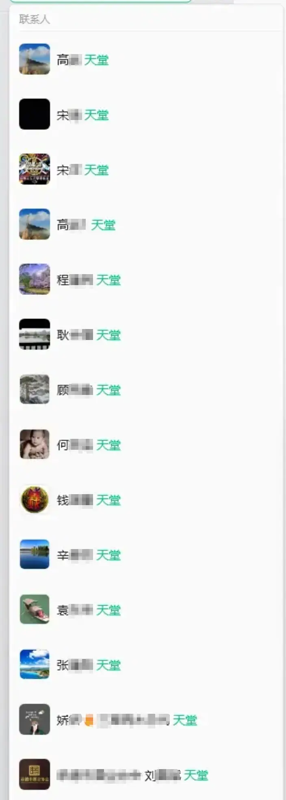

微信通讯录里，有一些人，已经不在了。

他们的头像还在，名字还在，点进去，仍然是熟悉的页面。只是我知道，再发过去的消息，不会有人回复了。

有人说，这样的联系人应该删掉，留着不吉利。

我却一直不舍得。

既然曾经加过微信，就是在人生的某一段路上有过交集。有的是朋友，有的是同事，有的来往多些，有的联系少些。相处之中，有过愉快，也未必没有过不愉快。

**好也好，不好也好，终究是认识过的人。**

如今人走了，回头再看，那些交情仍然值得记得，曾经的计较，也不必再计较了。我不想因为他们离开了，就顺手把名字也删去。对我而言，留着，是一份尊重。

于是，我在他们的名字后面，添上两个字：天堂。

这是我能想到的，一个安放这些名字的地方。每次看到，便在心里祝愿一句：愿你在那里，一切都好。

随着年岁渐长，通讯录里这样的备注慢慢多了起来。看见熟悉的名字，有时会想起那个人的模样，有时会记起一句话、一件小事。也有些人，具体的往来已经记不清了，但名字还认得，还知道我们曾经认识。

平时，我并不会特意去翻看。他们就静静地留在那里。偶然滑到，停一下，再继续往下看。日子照常过，故人也没有因此被完全遗忘。

我理解有人选择删除，每个人都有自己的告别方式。而我愿意在通讯录里，继续为他们留一个位置。

名字后面加上“天堂”，就像替一位久未联系的朋友，更新了地址。

此后不再打扰，愿你在那里安好。

